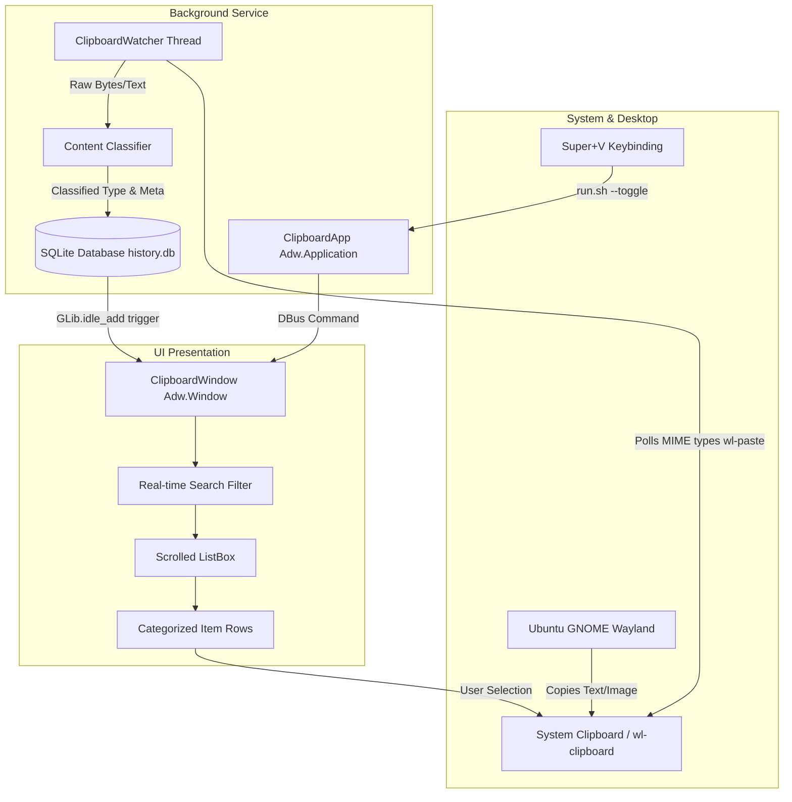

# Architecture & System Design

This document details the architecture, design choices, and data flows of **Clipboard Linux**.

---

## 1. High-Level Architecture Overview



---

## 2. Core Subsystems

### A. Background Watcher (`src/watcher.py`)
- Wayland security models prevent unprivileged apps from listening to arbitrary global inputs. Mutter (GNOME's Wayland compositor) implements standard Wayland clipboard protocols.
- The `ClipboardWatcher` operates on a background thread polling `wl-paste --list-types` with low CPU footprint (~20ms check every 400ms).
- When a change is detected:
  - If `image/png` or `image/jpeg` is present, binary data is captured, saved to `~/.local/share/clipboard_linux/images/`, and metadata (width, height, size) is extracted.
  - If text is present, UTF-8 text is fetched without trailing newline artifacts.
  - SHA-256 hashes prevent duplicate consecutive writes.

### B. Smart Classifier (`src/classifier.py`)
Incoming items are automatically parsed and tagged into 6 distinct categories:
1. **Hex / RGB Colors**:
   - Matches `#RGB`, `#RRGGBB`, `rgba(...)`.
   - Uses Euclidean color distance (`src/utils/color_names.py`) to assign human-readable color names (e.g. `Ubuntu Warm Primary`, `Dodger Blue`, `Orange Glow`).
2. **Terminal / CLI Commands**:
   - Detects common shell prefixes (`curl`, `sudo`, `docker`, `git`, `npm`, `apt`, `systemctl`, `ssh`, pipes `|`, redirects).
   - Renders with a terminal icon (`utilities-terminal-symbolic`).
3. **Web Links & Repositories**:
   - Matches HTTP/HTTPS and Git URIs.
   - Detects domains (e.g. `GitHub repository`, `YouTube video`, `Reddit post`).
4. **Code Snippets**:
   - Analyzes line count, syntax keywords (`def`, `func`, `class`, `{`, `}`, `=>`), indentation.
   - Displays monospace preview with line count hint.
5. **Images**:
   - Generates high-DPI thumbnails (`.thumb.png`) using `PIL.ImageOps.fit` to maintain fixed 44×32 aspect ratio.
   - Computes resolution and human-readable file size (`1920×1080 • 1.8 MB`).
6. **Plain Text**:
   - Clean truncation with timestamp.

### C. Persistent Storage Layer (`src/storage.py`)
- Uses SQLite with WAL (Write-Ahead Logging) compatibility:
  ```sql
  CREATE TABLE clipboard_items (
      id INTEGER PRIMARY KEY AUTOINCREMENT,
      item_type TEXT NOT NULL,
      title TEXT NOT NULL,
      subtitle TEXT,
      raw_content TEXT,
      image_path TEXT,
      metadata_json TEXT,
      created_at TIMESTAMP DEFAULT CURRENT_TIMESTAMP,
      pinned INTEGER DEFAULT 0
  );
  CREATE INDEX idx_created_at ON clipboard_items(created_at DESC);
  ```
- Fast substring search indexing `title`, `subtitle`, and `raw_content`.

### D. Single-Instance & IPC (`src/main.py`)
- `Adw.Application` runs with `Gio.ApplicationFlags.HANDLES_COMMAND_LINE`.
- On startup, the application calls `self.hold()`, remaining active in memory without exiting even when the window is hidden.
- When `run.sh --toggle` is called via keybinding (`Super+V`), the secondary instance routes arguments to the primary instance over DBus:
  - If window is currently visible: hides window (`set_visible(False)`).
  - If window is hidden: refreshes dataset, presents window (`present()`), and auto-focuses search field.
